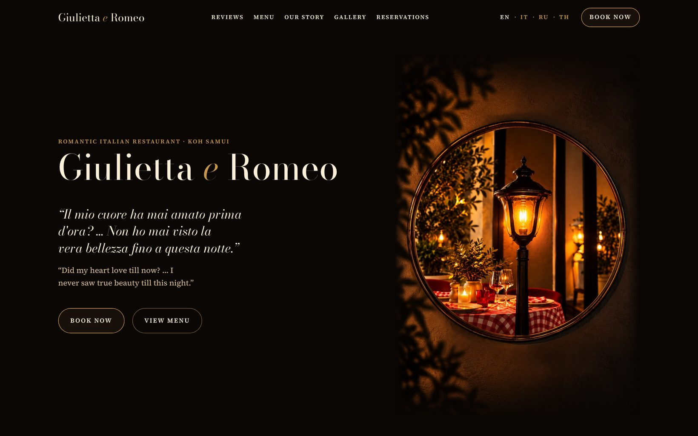

<div align="center">



# Giulietta e Romeo — сайт ресторана

**Сайт семейного итальянского ресторана на Самуи: меню текстом, четыре языка, бронь через WhatsApp.**

[**Открыть пробную версию →**](https://jw-git-hub.github.io/giuliettaeromeokohsamui.com/)

[Русский](#русский) · [English](#english)

</div>

---

## Русский

### Что это

Giulietta e Romeo — семейный итальянский ресторан в Чавенге, на острове Самуи.
Здесь новый сайт ресторана: тексты, фотографии и вечернее настроение —
ресторана, а сам сайт собран заново, чтобы гостю было удобно с телефона.

Сейчас сайт работает на пробном адресе и закрыт от поиска. Итальянская,
русская и тайская версии — черновики: они выйдут на адрес ресторана после
вычитки носителем языка.

На пробной версии вместо телефона и WhatsApp ресторана стоят заглушки:
форма брони открывает WhatsApp с готовым сообщением, но без получателя,
а кнопка звонка никуда не звонит. Настоящие контакты — только в сборке
для адреса ресторана.

### Что получает ресторан

- **Название — на первом экране.** Под фото сразу две кнопки: забронировать
  стол и открыть меню. Оценки Google и Tripadvisor — на втором экране.
- **Меню текстом.** Все 41 блюдо с описаниями и ценами в батах: читается
  на телефоне без увеличения, его видит поиск, а браузер гостя сам переводит
  описания. Фото категорий ведут к своим разделам меню.
- **Четыре языка.** Английский — текст ресторана без изменений; рядом
  итальянский, русский и тайский. Названия блюд не переводятся, цены одни
  на все языки. Язык гость выбирает сам.
- **Бронь через WhatsApp.** Гость заполняет форму на своём языке, а ресторану
  в WhatsApp приходит готовое сообщение по-английски: имя, дата, время,
  число гостей, пожелания. Сервер для этого не нужен.
- **Своя версия для компьютера.** Шапка с разделами, языками и кнопкой брони;
  часы работы и форма брони помещаются в один экран.
- **Открывается быстро и на мобильном интернете.** При открытии телефон
  скачивает около 0,3 МБ, остальные фото догружаются по мере прокрутки
  (замер 11 октября 2026). Шрифты свои, поэтому на iPhone, Android и Windows
  сайт выглядит одинаково.
- **Понятен поиску и ИИ-ассистентам.** Адрес, часы, телефон и меню с ценами
  записаны так, как их читают Google и ИИ-ассистенты; есть карта сайта.
  Ссылка, отправленная в WhatsApp или Telegram, приходит с фото ресторана.
- **Не нужен платный сервер.** Сайт — обычные файлы: их можно разместить
  на любом хостинге, в том числе бесплатном, и платить только за домен.

### Как вносятся правки

Меню лежит в одном файле: название и цена блюда записаны там один раз и сами
попадают на все четыре языка, в разметку для поиска и в карту для
ИИ-ассистентов. Перед каждой выкладкой сайт проверяет себя сам: английский
текст сверяется с текстом ресторана слово в слово, блюда и цены — с меню.
Если что-то разошлось, сайт не соберётся.

### Ссылки

- Пробная версия — <https://jw-git-hub.github.io/giuliettaeromeokohsamui.com/>
- Разбор работы человеческим языком — <https://jw-dev.pro/cases/giulietta-e-romeo/>
- Сделаю такой же сайт для вашего бизнеса — <https://jw-dev.pro>

<details>
<summary><b>Технические детали</b></summary>

**Стек.** Astro, только статика (`output: 'static'`): на выходе обычные файлы
в `dist/`, сервер приложений не нужен. Без React и Vue, без UI-библиотек,
CSS на переменных. Скрипты свои, на TypeScript: форма брони, нижняя панель
на телефоне, увеличение фото, меню на телефоне. Без них страница читается,
а форма уходит в WhatsApp обычной ссылкой.

**Языки.** Четыре версии из одного шаблона: `/` (английский), `/it/`, `/ru/`,
`/th/` — встроенный i18n Astro, без перенаправления по языку браузера.
Статус языка — в `src/i18n/registry.json`: `published` попадает в любую
сборку, `draft` — только в разработку и демо. У каждой версии свои заголовок,
описание, `lang` и `hreflang`.

**Где что лежит.**

```
content/texts.md        английские тексты ресторана дословно, ссылки, логика формы брони
content/menu.json       меню: 41 позиция, названия и цены — общие для всех языков
src/i18n/dictionaries/  тексты страницы, по файлу на язык (en.json сверяется с texts.md)
src/i18n/menu/          переводы описаний и заголовков разделов меню
src/i18n/registry.json  языки и их статус
src/config/             ссылки, телефон, часы, адрес по частям, правила формы брони; заглушки контактов для демо
src/components/         секции страницы, шапка, подвал, нижняя панель, элементы
src/scripts/            форма брони, нижняя панель, увеличение фото, меню на телефоне
src/assets/             фото и облегчённые шрифты
scripts/                проверки текстов, переводов, сборки и веса; картинка для мессенджеров, иконка, шрифты
tests/unit/             даты и сообщение брони (node:test)
tests/e2e/              приёмка в браузере: Playwright, Chromium и WebKit, axe
```

**Фото и шрифты.** Фото — через `astro:assets`: AVIF и WebP в нескольких
ширинах, ниже первого экрана — ленивая загрузка. Шрифты — Bodoni Moda
и Source Serif 4, для русского Prata, для тайского Noto Serif Thai;
облегчённые копии только с жирностями сайта (`npm run make:fonts`),
со своего хостинга, шрифт языка грузится только на его странице.

**Поиск и ИИ.** JSON-LD: WebSite, WebPage, Restaurant с адресом по частям,
часами и меню (Menu, MenuSection, MenuItem с ценой в THB), La Dolce Vita
и La Pasta. `sitemap.xml`, `robots.txt` с ИИ-роботами по именам, `llms.txt`
из английского словаря и меню — без новых фраз, это проверяет сборка.
Open Graph с картинкой 1200×630, иконка сайта. `public/.htaccess` для Apache:
сжатие и долгий кэш файлов с хэшем в имени.

**Команды.**

| Команда | Что делает |
|---|---|
| `npm run dev` | Локальный сервер, все четыре языка |
| `npm run build` | Боевая сборка в `dist/`: только опубликованные языки; до неё сверяются тексты, после — страницы и чистота сборки |
| `npm run build:demo` | Демо для GitHub Pages: закрыто от поиска, адрес и языки — из `.env.demo`, телефон и WhatsApp — заглушки |
| `npm run build:test` | Сборка для тестов: все языки, сайт в корне `localhost:4322` |
| `npm run preview` | Отдаёт `dist/` на `localhost:4322`, как хостинг |
| `npm run check:budget` | Вес первого экрана (до 450 КБ), всей страницы (до 2,5 МБ) и скриптов (до 10 КБ) — после сборки |
| `npm run test:unit`, `npm run test:e2e` | Тесты; e2e идут по собранному `dist/` |
| `npm run lint`, `npm run check` | Стиль кода и типы |

**Выкладка.** Демо собирается и выкладывается на GitHub Pages при каждом пуше
в `main` (`.github/workflows/demo.yml`): если проверки не прошли, на Pages
остаётся прежняя версия. Боевая сборка — `npm run build`, содержимое `dist/`
кладётся на любой статический хостинг.

</details>

### Права

Тексты, фотографии, логотипы и меню принадлежат ресторану Giulietta e Romeo
и лежат здесь только ради показа сайта. Репозиторий открыт для ознакомления.

---

## English

### What this is

Giulietta e Romeo is a family-run Italian restaurant in Chaweng, on the island
of Koh Samui. This is the restaurant’s new website: the text, the photos, and
the evening mood are the restaurant’s own, and the site itself was rebuilt
from scratch to be easy to use on a phone.

For now, the site runs at a test address and is closed to search engines.
The Italian, Russian, and Thai versions are drafts: they will go live at the
restaurant’s address after a native speaker proofreads them.

On the test version, the restaurant’s phone number and WhatsApp are replaced
with placeholders: the booking form opens WhatsApp with a ready-to-send
message but no recipient, and the call button doesn’t call anyone. The real
contact details are only in the build for the restaurant’s address.

### What the restaurant gets

- **The name on the first screen.** Right under the photo there are two
  buttons: book a table and open the menu. The Google and Tripadvisor ratings
  are on the second screen.
- **A text menu.** All 41 dishes with descriptions and prices in baht: it is
  readable on a phone without zooming, search engines can see it, and the
  guest’s browser translates the descriptions on its own. The category photos
  lead to their sections of the menu.
- **Four languages.** English is the restaurant’s own text, unchanged; next
  to it are Italian, Russian, and Thai. Dish names aren’t translated, and the
  prices are the same in every language. Guests choose the language themselves.
- **Booking through WhatsApp.** The guest fills in a form in their own
  language, and the restaurant receives a ready-to-send message in English on
  WhatsApp: name, date, time, number of guests, special requests. No server is
  needed for this.
- **Its own version for computers.** A header with the sections, languages,
  and a booking button; the opening hours and the booking form fit on one
  screen.
- **Opens fast, even on mobile internet.** On opening, a phone downloads about
  0.3 MB, and the rest of the photos load as the guest scrolls (measured on
  October 11, 2026). The fonts are the site’s own, so it looks the same on
  iPhone, Android, and Windows.
- **Readable by search engines and AI assistants.** The address, hours, phone
  number, and the menu with prices are written the way Google and AI
  assistants read them, and there is a sitemap. A link sent on WhatsApp or
  Telegram arrives with a photo of the restaurant.
- **No paid server needed.** The site is plain files: it can be hosted
  anywhere, including for free, and the only cost is the domain.

### How edits work

The menu lives in one file: a dish’s name and price are written there once and
go by themselves to all four languages, the search markup, and the map for AI
assistants. Before every release, the site checks itself: the English text is
compared word for word with the restaurant’s text, and the dishes and prices
with the menu. If anything differs, the site won’t build.

### Links

- Test version: <https://jw-git-hub.github.io/giuliettaeromeokohsamui.com/>
- The work explained in plain words: <https://jw-dev.pro/en/cases/giulietta-e-romeo/>
- I can build a website like this for your business: <https://jw-dev.pro/en/>

<details>
<summary><b>Technical details</b></summary>

**Stack.** Astro, static only (`output: 'static'`): the output is plain files
in `dist/`, and no application server is needed. No React or Vue, no UI
libraries, CSS with custom properties. The scripts are the site’s own, in
TypeScript: the booking form, the phone bottom bar, photo zoom, the phone
menu. Without them the page is still readable, and the form goes to WhatsApp
as a plain link.

**Languages.** Four versions from one template: `/` (English), `/it/`, `/ru/`,
`/th/`, using Astro’s built-in i18n, with no redirect by browser language.
Each language’s status is in `src/i18n/registry.json`: `published` goes into
any build, `draft` only into development and the demo. Each version has its
own title, description, `lang`, and `hreflang`.

**What’s where.**

```
content/texts.md        the restaurant's English text word for word, links, booking form logic
content/menu.json       the menu: 41 items, names and prices shared by all languages
src/i18n/dictionaries/  page text, one file per language (en.json is checked against texts.md)
src/i18n/menu/          translated dish descriptions and menu section headings
src/i18n/registry.json  languages and their status
src/config/             links, phone, hours, address in parts, booking form rules; placeholder contacts for the demo
src/components/         page sections, header, footer, bottom bar, UI elements
src/scripts/            booking form, bottom bar, photo zoom, phone menu
src/assets/             photos and lightweight fonts
scripts/                checks for text, translations, build, and weight; social preview image, icon, fonts
tests/unit/             dates and the booking message (node:test)
tests/e2e/              browser acceptance tests: Playwright, Chromium and WebKit, axe
```

**Photos and fonts.** Photos go through `astro:assets`: AVIF and WebP in
several widths, lazy-loaded below the first screen. Fonts are Bodoni Moda and
Source Serif 4, Prata for Russian, Noto Serif Thai for Thai; lightweight
copies with only the site’s weights (`npm run make:fonts`), self-hosted, and
a language’s font loads only on its own page.

**Search and AI.** JSON-LD: WebSite, WebPage, Restaurant with the address in
parts, opening hours, and the menu (Menu, MenuSection, MenuItem with a price
in THB), La Dolce Vita and La Pasta. `sitemap.xml`, `robots.txt` naming AI
crawlers, `llms.txt` built from the English dictionary and the menu with no
new phrases, which the build checks. Open Graph with a 1200×630 image, a site
icon. `public/.htaccess` for Apache: compression and long caching for files
with a hash in the name.

**Commands.**

| Command | What it does |
|---|---|
| `npm run dev` | Local server, all four languages |
| `npm run build` | Production build into `dist/`: published languages only; text is checked before, pages and build cleanliness after |
| `npm run build:demo` | Demo for GitHub Pages: closed to search engines, address and languages from `.env.demo`, placeholder phone and WhatsApp |
| `npm run build:test` | Build for tests: all languages, site at the root of `localhost:4322` |
| `npm run preview` | Serves `dist/` on `localhost:4322`, like a host would |
| `npm run check:budget` | Weight of the first screen (up to 450 KB), the whole page (up to 2.5 MB), and scripts (up to 10 KB), after the build |
| `npm run test:unit`, `npm run test:e2e` | Tests; e2e runs against the built `dist/` |
| `npm run lint`, `npm run check` | Code style and types |

**Deployment.** The demo is built and deployed to GitHub Pages on every push
to `main` (`.github/workflows/demo.yml`): if a check fails, Pages keeps the
previous version. The production build is `npm run build`; the contents of
`dist/` go to any static host.

</details>

### Rights

The text, photos, logos, and menu belong to the Giulietta e Romeo restaurant
and are included here only to show the website. The repository is public for
reference.
